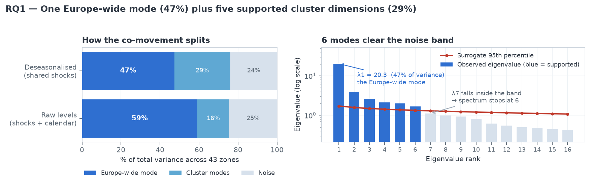
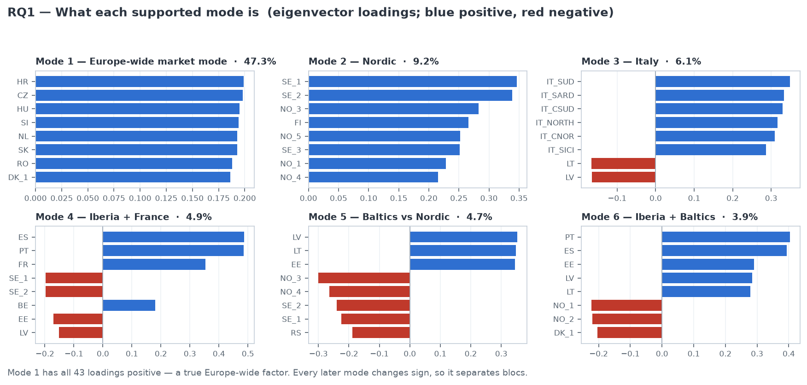
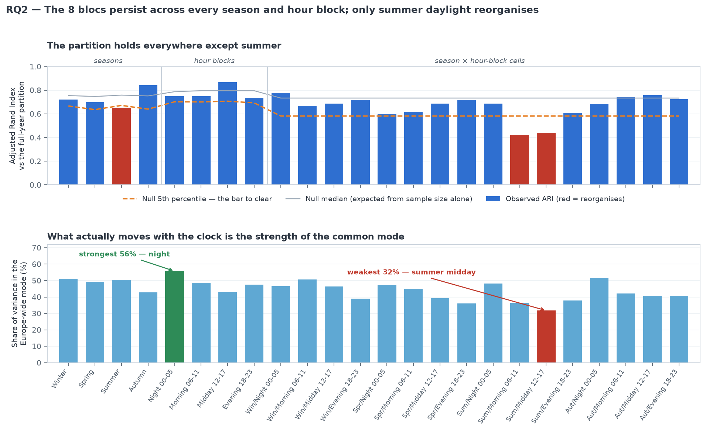
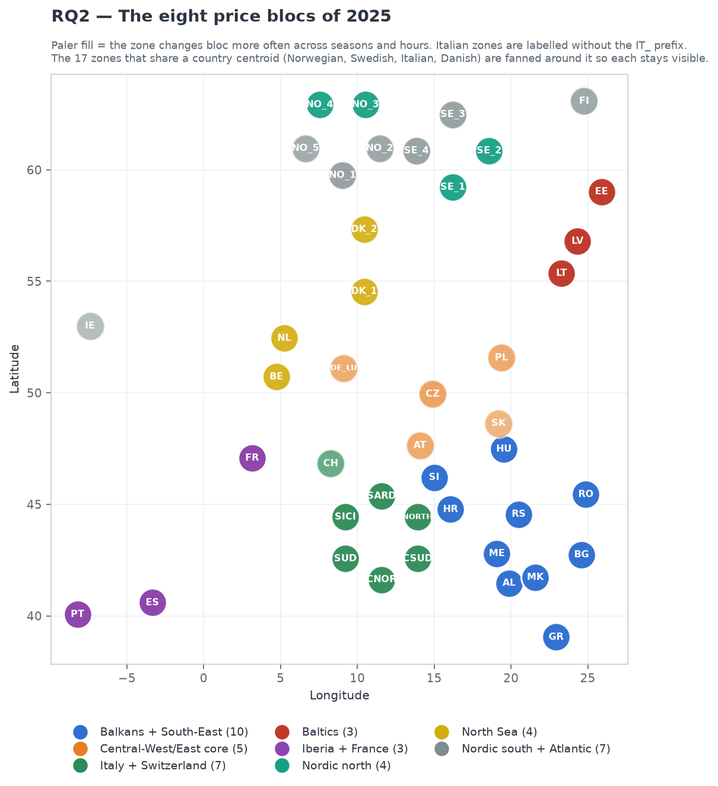
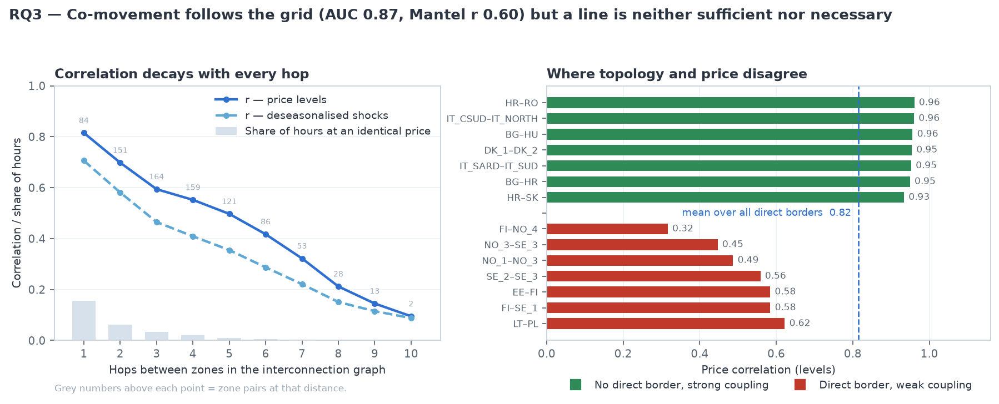

# RQ1–RQ3 — the answers

European electricity prices, 43 bidding zones, 8,401 complete hours of 2025.
Each answer below is self-contained: the finding, what it means, the picture, and
where every number came from.

Long version with all tables and method detail: **[research_questions.md](research_questions.md)**.
Interactive version: **[the dashboard](https://idfepam.github.io/energy/)** → tabs
*RQ1 · Modes*, *RQ2 · Persistence*, *RQ3 · Topology*.

Reproduce all of it:

```bash
PYTHONPATH=src python3 -m energy_collect.cli analyze-comovement --year 2025
python3 scripts/build_rq_figures.py --year 2025
```

---

## RQ1 — How much of European price co-movement is a single Europe-wide mode, how much is cluster-specific, and how many cluster dimensions are statistically supported?

> **One Europe-wide mode carries 47% of the variance. Five cluster dimensions are
> statistically supported and carry a further 29%. The remaining 24% is zone-specific
> noise.**
>
> The Europe-wide mode is a *true* common factor, not a contrast between two halves of
> Europe: all 43 of its loadings have the same sign, so it moves every zone in the same
> direction at once. The five cluster dimensions are Nordic, Italian, Iberian, Baltic
> and an Iberian–Baltic contrast.
>
> On raw price levels the common mode instead reads 59%. That extra **12 percentage
> points is the shared European daily and seasonal calendar**, not shared market
> shocks — which is why every number here is computed on deseasonalised prices.





**Where the numbers came from**

| | |
|---|---|
| Data | ENTSO-E day-ahead prices (document **A44**), 2025, 43 bidding zones → `data/processed/entsoe/prices_2025.parquet` |
| Preparation | averaged to hourly UTC (some TSOs moved to a 15-min market time unit on 1 Oct 2025), then hour-of-day, day-of-week, month-of-year and 7-day trend removed → `prices_deseasonalised_2025.parquet`. 8,401 hours are complete for all 43 zones. |
| Method | eigen-decomposition of the 43×43 Pearson correlation matrix. 47% = λ₁/N = 20.35/43. 29% = (λ₂+…+λ₆)/N. |
| Significance | **500 phase-randomised surrogates** — each keeps a zone's own power spectrum (so its autocorrelation) and randomises Fourier phases, destroying all cross-zone coupling. A mode counts only if it beats the 95th percentile of its own rank in that null. λ₁…λ₆ do; λ₇ = 1.11 against a band of 1.29 does not. |
| Cross-check | Marchenko–Pastur with an autocorrelation-adjusted sample size. Mean AR(1) = 0.83 means 8,401 hours are worth ≈ **801** independent observations, moving the bound from 1.15 to **1.52**. Also returns 6 modes. |
| Code | `eigen_spectrum()` in [`src/energy_collect/comovement.py`](../src/energy_collect/comovement.py) |
| Output | `data/manifests/comovement_2025.json` → `rq1` |

---

## RQ2 — Do the price clusters persist across seasons and intraday, or does the partition reorganise?

> **They persist. The eight blocs survive every season and every time of day. The only
> genuine reorganisation is summer daylight — 3 of 24 strata, all of them summer.**
>
> What does change with the clock is not *who is in which bloc* but *how strong the
> Europe-wide mode is*: it runs from **56% at night down to 32% in summer midday**. The
> hours with the most solar output are the hours when Europe prices least as one market.
>
> Iberia and the Baltics never move. The movement is concentrated on the Central-European
> seam — DE_LU, AT, PL, SK, CZ — and on IE_SEM.





**Where the numbers came from**

| | |
|---|---|
| Data | the same deseasonalised hourly price panel as RQ1 |
| Blocs | average-linkage clustering on `sqrt(2(1−C))`, where C is the correlation **rebuilt from modes 2…6 only**. Dropping mode 1 matters: leaving the Europe-wide mode in makes every zone look similar to every other zone. |
| Choice of k=8 | smallest k within 0.01 silhouette of the best across k = 2…12, excluding any partition with a one-zone cluster. Silhouette 0.57. |
| Comparison | **Adjusted Rand Index** against the full-year partition, for 4 seasons, 4 six-hour blocks and 16 season × hour cells. |
| The bar to clear | a **permutation null of identical sample size** — random days for a season, random hours-of-day for an hour block, both for a cell, 120 replications each. This matters: a quarter of the year gives ARI ≈ 0.76 even when nothing reorganised, so raw ARI alone would be misread. A stratum counts as reorganised only below the null's 5th percentile. |
| Result | ARI 0.42–0.87 across 24 strata. Below the null: Summer (0.65 vs 0.67), Summer/Morning (0.42 vs 0.58), Summer/Midday (0.44 vs 0.58). No season or hour block on its own reorganises. |
| Robustness | mean ARI stays 0.63–0.78 for every k from 5 to 10, so the answer does not depend on the cluster count. |
| Code | `stratified_partitions()`, `adjusted_rand_index()`, `select_k()` in [`comovement.py`](../src/energy_collect/comovement.py) |
| Output | `data/manifests/comovement_2025.json` → `rq2` |

---

## RQ3 — Does price co-movement follow the physical interconnection topology, and where does it diverge?

> **Yes, closely — but a transmission line turns out to be neither sufficient nor
> necessary for prices to move together.**
>
> Correlation falls monotonically with every extra hop through the grid, from **0.82 at
> one hop to 0.10 at ten**. Adjacency is recovered at **AUC 0.87** and the Mantel
> correlation between price distance and hop distance is **0.60** (p = 0.0002). Topology
> explains most of the picture.
>
> The exceptions run in both directions and are systematic:
> - **Direct border, weak coupling** — FI–NO_4 (r = 0.32), NO_3–SE_3 (0.45), NO_1–NO_3
>   (0.49). Internal Nordic borders where congestion binds essentially all the time:
>   NO_1–NO_3 settles at the same price in only 1.2% of hours.
> - **No direct border, strong coupling** — HR–RO (0.96), BG–HU (0.96), IT_CSUD–IT_NORTH
>   (0.96), all two hops apart. Zones inside one coupled bloc, where the market clears the
>   whole region at once.
>
> Border capacity explains part of it but not most: over the 30 borders with a trustworthy
> per-border capacity figure, log NTC correlates **r = 0.39** with price coupling.



**Where the numbers came from**

| | |
|---|---|
| Co-movement | the same 2025 hourly price panel; correlations on raw levels (market integration) with deseasonalised residuals as a cross-check — both decay in the same shape |
| Topology | the border list in [`config/zones.yaml`](../config/zones.yaml), restricted to the 43 zones in the panel → **84 direct borders**; hop distance by breadth-first search over that graph |
| Decay profile | all 903 zone pairs grouped by hop distance (84 pairs at 1 hop, 151 at 2, …) |
| AUC 0.87 | Mann–Whitney U of correlation on the 84 direct borders vs the 819 other pairs, p ≈ 2×10⁻²⁹ |
| Mantel r 0.60 | 5,000 permutations of the zone labels, comparing the price-distance matrix to the hop-distance matrix |
| Convergence | share of hours where two zones settle within 0.01 EUR/MWh — the standard sign that a border is *not* congested. Computed from prices, so it is available for every pair. |
| Capacity | ENTSO-E net transfer capacity (document **A61**) |
| Code | `topology_comparison()` in [`comovement.py`](../src/energy_collect/comovement.py) |
| Output | `data/manifests/comovement_2025.json` → `rq3` |

**One data caveat, stated up front.** ENTSO-E republishes each zone's *aggregate* export
against every one of its borders. The project's `flow_validation` already found this for
physical flows (A11); the same defect is in the capacity data (A61) — France publishes
2,801 MW identically on BE, DE_LU and IT_NORTH, Germany 1,185 MW on 8 of its 11 borders.
Those are zone totals, not border figures, and using them would manufacture a result, so
they are excluded:

| Source | Published | Usable per-border |
|---|---|---|
| Net transfer capacity (A61) | 108 borders | **37** |
| Directed physical flows (A11) | 177 pairs | **2** |

Every correlation, convergence and spread figure above comes from the **price panel**,
which has no such defect.

`DK_1–DK_2` appears as a strongly coupled "non-adjacent" pair, but the Great Belt HVDC
link physically connects them — it is simply absent from both `zones.yaml` and the
ENTSO-E border data. That one is a topology-data gap, not a market finding.

---

## The three answers together

1. Europe is **one market plus five cluster dimensions**. The common mode is large but
   far from total, and a quarter of all price variation is purely local.
2. Those clusters are **structural, not seasonal**. They hold through winter and summer,
   night and evening. Only summer daylight breaks them, when solar drives the common
   mode down to 32%.
3. The clusters **follow the grid, with two systematic exceptions**: congested borders
   where a line cannot enforce one price, and coupled blocs where the market clears
   zones together regardless of direct connection.

The recurring theme across all three: **market-coupling membership, not copper, sets the
partition.**

## What is still open

- `DK_1–DK_2` (Great Belt) is missing from the topology config and from ENTSO-E flow/NTC data.
- GB has no 2025 ENTSO-E data, so the entire GB–continent interface is invisible to all three questions.
- Per-border capacity exists for 37 of 108 borders; PyPSA-Eur line ratings would let RQ3 test the capacity hypothesis on all of them.
- One year only. RQ2 answers persistence *within* 2025; a second year would show whether the partition itself is stable year to year.
